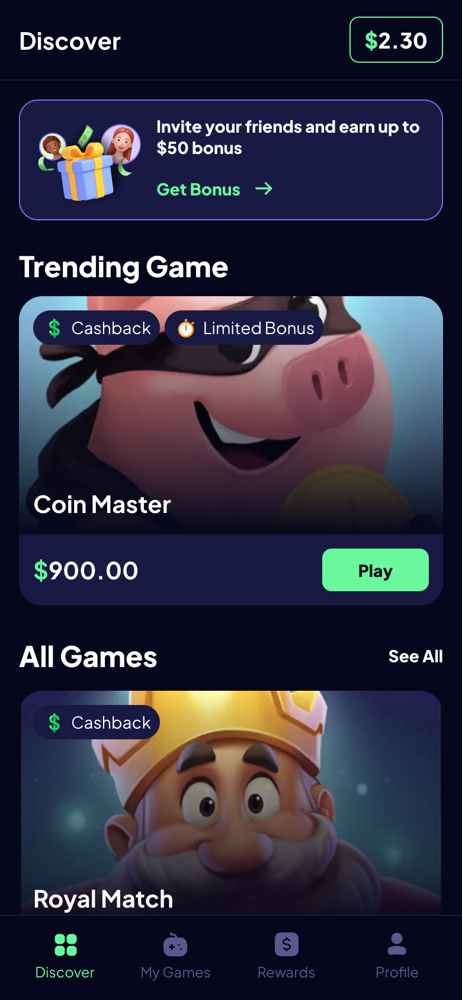
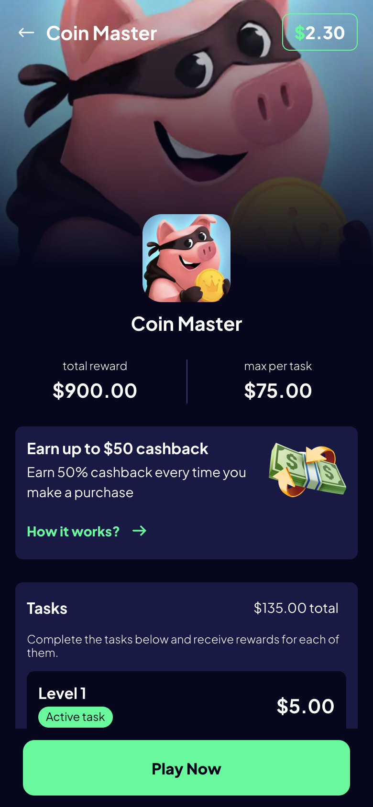
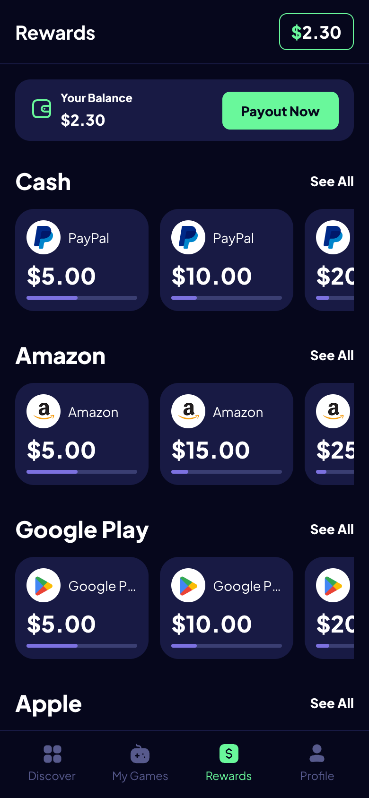
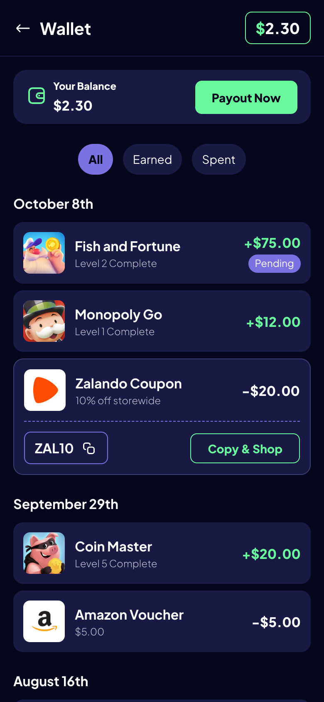
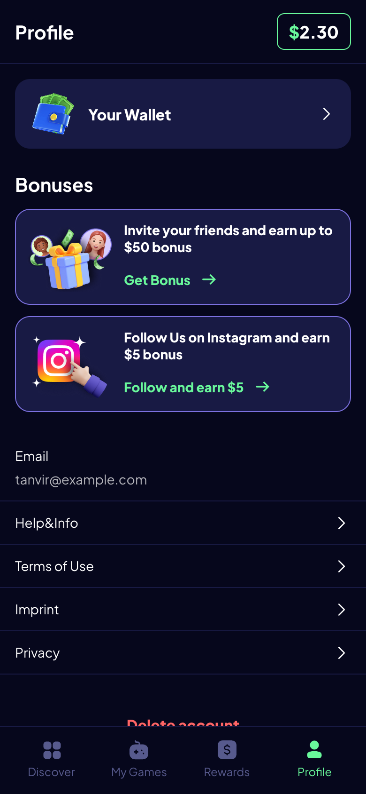
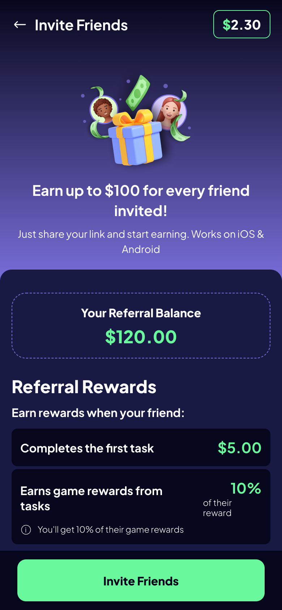

# Getting Started — Create Your Own PlayZone Sheet

This guide walks a non-technical sheet owner through creating a brand-new Google Sheet that
this app can render, filling in every field correctly, and using the app once it's live. No
code changes are needed — the entire app is driven by one Google Sheet.

For the deeper technical reference (exact validation rules, error codes, etc.), see
[`docs/01-data-model.md`](docs/01-data-model.md) and [`docs/03-sheets-integration.md`](docs/03-sheets-integration.md).
This document is the practical, step-by-step version of those.

## How this works, in one paragraph

The app has no database and no backend. Every screen — Discover, Game Detail, Rewards,
Wallet, Profile, Invite — is rendered live from a single public Google Sheet with 6 specific
tabs. Which sheet it reads is controlled entirely by the URL: paste your sheet's ID into the
link, share the link, and anyone who opens it sees your content. There is nothing to deploy or
configure beyond the spreadsheet itself.

---

## Step 1 — Copy the template

1. Open the [`seed/`](seed/) folder in this repo. It contains 6 `.tsv` files — one per tab —
   already filled with real demo content, so you're editing a working example rather than
   starting from a blank grid.
2. Create a new Google Sheet at [sheets.google.com](https://sheets.google.com).
3. Create **6 tabs**, named **exactly** these, all lowercase:
   `games`, `tasks`, `rewards`, `wallet`, `settings`, `content`.
4. For each tab: open the matching `.tsv` file from `seed/` in a text editor, select all,
   copy, click cell `A1` in that tab, and paste. Google Sheets automatically splits
   tab-separated values into columns.
5. Keep header row 1 exactly as pasted in every tab — the app checks for these exact column
   names (see Step 2–7 below) and fails to load if any are missing or renamed.

## Step 2 — Fill in the `games` tab

This tab powers the game cards on Discover and the Game Detail screen.

| Column | Required | What to put in it |
|---|---|---|
| `id` | Yes | A stable short ID, must look like `g1`, `g2`, `g3`, ... Never reuse an ID, never change it once tasks reference it. |
| `name` | Yes | The game's title, e.g. `Coin Master`. Shown on the card and the Game Detail header. |
| `image_url` | Yes | A direct image link (see "Image hosting" below). Used as both the card art and the Game Detail hero/icon. |
| `description` | Yes | One short line. Currently not shown on screen but kept as a stable field — fill it in anyway. |
| `total_reward` | Yes | The headline reward amount, pre-formatted exactly as you want it to appear, e.g. `$900.00`. The app never adds a `$` itself — type it exactly as it should look. |
| `max_per_task` | Yes | The max reward per task, e.g. `$75.00`, shown as a stat on Game Detail. |
| `long_description` | Yes | The paragraph shown in the Game Detail "Description" card. |
| `has_cashback` | Yes | Must be exactly `TRUE` or `FALSE` (all caps). Shows the green "Cashback" badge when `TRUE`. **Never translate this value.** |
| `has_limited_bonus` | Yes | Must be exactly `TRUE` or `FALSE`. Shows the "Limited Bonus" badge when `TRUE`. **Never translate this value.** |
| `href` | Yes (column must exist; individual cells may be blank) | The Play Store or App Store link for this game. Powers the "Play Now" button on Game Detail and the "Play" pill on the Discover card — tapping either opens this URL. If you leave a row's `href` blank, that game's Play button/pill just appears dimmed and does nothing, instead of the app breaking. |

**Convention:** row 2 (the first data row under the header) is always shown as the single
"Trending Game" at the top of Discover. Every row (including that one again) also appears in
the "All Games" list below it.

## Step 3 — Fill in the `tasks` tab

Each row is one task belonging to one game.

| Column | Required | What to put in it |
|---|---|---|
| `game_id` | Yes | Must exactly match a `games.id` value, e.g. `g1`. This is how a task is linked to its game. |
| `name` | Yes | e.g. `Level 1`, `Level 2`. |
| `amount` | Yes | Pre-formatted reward for completing this task, e.g. `$5.00`. |
| `is_active` | Yes | `TRUE` or `FALSE` (all caps). The row with `TRUE` shows the green "Active task" badge. Keep at most one `TRUE` per game. |

Tasks render top-to-bottom in the order you enter them, grouped by `game_id`. The "Tasks ...
total" badge on Game Detail is calculated automatically (sum of that game's task amounts) —
you don't need to total it yourself.

## Step 4 — Fill in the `rewards` tab

Each row is one payout card shown on the Rewards screen and its own Reward Detail page.

| Column | Required | What to put in it |
|---|---|---|
| `id` | Yes | e.g. `r1`, `r2`. |
| `category` | Yes | Groups rewards into horizontal rows on the Rewards screen, e.g. `Cash`, `Amazon`, `Google Play`, `Apple`. You can use any category name you like. |
| `brand` | Yes | Logo label on the card. Use exactly `PayPal`, `Amazon`, `Google Play`, or `Apple` to get a real logo graphic; any other text still works, just shown as a colored letter instead of a logo. |
| `amount` | Yes | Pre-formatted payout amount, e.g. `$10.00`. |
| `reward_detail_how_1` / `_2` / `_3` | Yes | The 3 "How it works" bullet points on that reward's detail page. |
| `reward_detail_conditions_1` / `_2` | Yes | The 2 "Conditions" bullet points. |
| `reward_detail_disclaimer` | Yes | The disclaimer text box at the bottom of the detail page. |

The progress bar under each reward's amount is calculated automatically from
`settings.balance` vs. that row's `amount` — there's no column for it.

## Step 5 — Fill in the `wallet` tab

Each row is one entry in the Wallet transaction history.

| Column | Required | What to put in it |
|---|---|---|
| `date` | Yes | Free text group header, e.g. `October 8th`. Rows with the same `date` text are grouped together; it is not parsed as a real date. |
| `type` | Yes | Must be exactly `earned` or `spent` (lowercase). Controls the `+`/`-` sign and the Earned/Spent filter chip. **Never translate this value.** |
| `name` | Yes | e.g. a game name, `Survey`, or a coupon title. |
| `subtitle` | Yes | e.g. `Level 10 Complete`, or a coupon subtitle. |
| `amount` | Yes | Pre-formatted, e.g. `$75.00`. Enter it as a positive number — the `+`/`-` sign is added automatically from `type`. |
| `status` | No | Leave blank, or type `Pending` to show the purple "Pending" badge. |
| `icon_url` | Yes | A direct image link for the 50px row icon (see "Image hosting" below). |
| `coupon_code` | No | Leave blank for a normal row. Fill in a code (e.g. `ZAL10`) to show the taller coupon card with a code box and "Copy & Shop" button. |

## Step 6 — Fill in the `settings` tab

A simple 2-column `key` / `value` tab — one setting per row, not a table of records.

| Key | Required | Example value | Where it's used |
|---|---|---|---|
| `balance` | Yes | `$2.30` | Wallet pill in the top nav, Rewards balance card, Wallet balance card |
| `referral_balance` | Yes | `$120.00` | Invite screen "Your Referral Balance" |
| `referral_first_task` | Yes | `$5.00` | Invite screen's reward rule for a friend's first task |
| `referral_pct` | Yes | `10` | Invite screen's "xx%" of a friend's game rewards (no `%` needed — the app adds it) |
| `currency_symbol` | No | `$` or `€` | The symbol the app uses for tinted amounts. If omitted, the app guesses it from your data. |
| `currency_position` | No | `prefix` or `suffix` | Whether the symbol goes before (`$5.00`) or after (`5,00€`) the number. |
| `number_locale` | No | `en-US` or `de-DE` | Controls decimal/thousands separators. Defaults to `en-US`. |

**Important:** `balance`, `referral_balance`, and `referral_first_task` must be entered as
**plain text**, not Sheets' auto-formatted currency/number type — otherwise Sheets may
silently reformat them. If a cell shows a green triangle or right-aligns itself like a number,
re-enter it as text (Format → Number → Plain text) before typing the value again.

## Step 7 — Fill in the `content` tab

Also a `key` / `value` tab. This holds every piece of static UI copy — button labels, screen
titles, section headers — so you can reword anything (or translate it) without touching code.

The template already has all required keys filled in with working copy — the easiest path is
to only edit the **values**, never delete or rename a **key**. There are 73 required keys in
total; see the full list and what each one controls in
[`docs/01-data-model.md`](docs/01-data-model.md#content-keyvalue--all-static-screen-text). If
you accidentally delete one, the app will tell you exactly which key is missing when it tries
to load.

## Step 8 — Image hosting (imgbb)

`games.image_url`, `wallet.icon_url`, and any other image field need a **direct image link** —
a URL that ends up serving the raw image file, not a webpage that contains the image. Google
Drive share links, Dropbox links, etc. generally do **not** work here because they serve an
HTML viewer page instead of the raw file.

The recommended free option is **[imgbb.com](https://imgbb.com/)**:

1. Go to [imgbb.com](https://imgbb.com/) and click **Start uploading**.
2. Upload your game icon / art / coupon icon (no account required, though creating a free one
   makes your images easier to find and manage later).
3. After the upload finishes, click on the image, then find and copy the **"Direct link"**
   URL — it will look like `https://i.ibb.co/xxxxxxx/your-file.png`.
4. Paste that **direct link** into the sheet's `image_url` / `icon_url` cell — not the imgbb
   page URL, not the "Viewer link", not the HTML embed code. Just the plain direct link.

A quick way to check you have the right link: paste it into a new browser tab. If you see just
the image by itself (no imgbb page around it), it's correct.

## Step 9 — Share the sheet

The app reads your sheet without logging in, so it must be shared publicly for viewing:

1. In your Google Sheet, click **Share** (top right).
2. Under **General access**, change it to **Anyone with the link**.
3. Set the role to **Viewer**.
4. Click **Done**.

If you skip this step, the app will show a "this spreadsheet isn't publicly readable" error —
nobody but you (or people you've explicitly shared it with) will be able to open it.

## Step 10 — Get your Sheet ID and open the app

Your sheet's ID is the long string of letters/numbers in its URL:

```
https://docs.google.com/spreadsheets/d/1AbCdEfGhIjKlMnOpQrStUvWxYz1234567890/edit
                                        \_______________ this part _______________/
```

Open the app with that ID in the hash, right after the `#/`:

```
https://tanvir-azad-de.github.io/pz/#/1AbCdEfGhIjKlMnOpQrStUvWxYz1234567890/discover
```

(Pasting your full Sheets edit URL after the `#/` also works — the app extracts the ID out of
it automatically.)

That's it — no deploy, no build, no code change. Edit any cell in your sheet, reload the app,
and your change appears.

---

## Using the app

Once your link opens successfully, you'll land on **Discover**. Here's what each screen shows
and how the sheet data maps onto it.

### Discover



- The top card is the Invite banner (`content.invite_card_discover_text`).
- "Trending Game" is always `games` row 2 (the first data row).
- "All Games" lists every row in `games`, in sheet order.
- Each card's **Play** pill opens that game's `games.href` link directly (Play Store / App
  Store). Tapping the rest of the card instead opens that game's own detail screen.
- If a game's `href` is blank, its Play pill is shown dimmed; tapping it falls through to the
  detail screen instead of doing nothing.

### Game Detail



Tap any game card to get here. This screen is built entirely from one `games` row plus that
game's `tasks` rows:

- Hero image + icon: `games.image_url`.
- Total reward / max per task stats: `games.total_reward` / `games.max_per_task`.
- "Tasks ... total" badge: calculated automatically from `tasks.amount` for this game.
- Description card: `games.long_description`.
- **Play Now** button at the bottom: opens `games.href`. If that row's `href` is blank, the
  button appears dimmed and does nothing when tapped.

### Rewards



- Balance card at the top: `settings.balance`.
- Each horizontal row is one `rewards.category` value, containing every reward row in that
  category, in sheet order.
- Tapping a reward card opens its own detail page, built from that row's
  `reward_detail_how_*` / `reward_detail_conditions_*` / `reward_detail_disclaimer` columns.

### Wallet



- Reached from the Profile screen's wallet row, or the balance pill in the top nav bar.
- Rows are grouped by `wallet.date`, in the order you entered them.
- The `+`/`-` sign is automatic based on `wallet.type` (`earned` → `+`, `spent` → `-`).
- A row with a non-blank `coupon_code` renders as a taller coupon card with a "Copy & Shop"
  button.

### Profile



- Bonuses section is built from the `content` tab's `bonus_1_*` / `bonus_2_*` keys.
- Email and the Help/Terms/Imprint/Privacy menu rows all come from `content` keys.

### Invite



- Reached from the "Get Bonus" buttons on Discover and Profile.
- Referral balance and reward rules come straight from `settings.referral_balance`,
  `settings.referral_first_task`, and `settings.referral_pct`.

---

## Troubleshooting

The app shows a specific error screen for every way a sheet can be invalid — it never shows a
blank page. If something looks wrong, check which message you're seeing:

| What you see | What it means | How to fix it |
|---|---|---|
| "No spreadsheet specified" | The URL hash has nothing after `#/` | Add your sheet ID to the URL as shown in Step 10 |
| "That doesn't look like a Google Sheet ID" | The text after `#/` isn't a real-looking sheet ID | Double-check you copied the ID (or full edit URL), not something else |
| "Spreadsheet not found" | The ID doesn't match any real sheet (HTTP 404) | Check for typos in the ID |
| "This spreadsheet isn't publicly readable" | Sharing isn't set to "Anyone with the link" | Redo Step 9 |
| "This isn't a valid PlayZone spreadsheet" (names a tab + missing columns) | A tab is missing one or more required columns | Reopen that tab, compare its header row against Steps 2–7, re-paste from `seed/` if needed |
| An error naming specific missing keys | `settings` or `content` is missing a required key, or it's blank | Find that exact key in the tab and fill it in — don't delete keys from the template |
| "Couldn't load data" + Retry button | Network hiccup | Click Retry, or check your internet connection |

**A note on `games.href`:** this column is required to exist — a sheet without it at all will
fail to load with a "missing columns" error. Individual **rows** may still leave `href` blank;
that just makes Play Now dimmed/inactive for that one game rather than failing the whole sheet.
